<p align="center">
  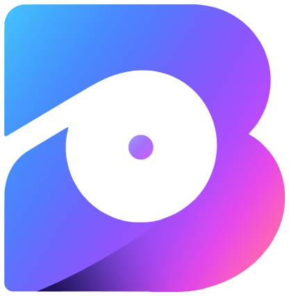
</p>

<h1 align="center">Backspn</h1>

<p align="center">
  Free, open source and made for any controller<br>
  macOS · Windows · Linux
</p>

<p align="center">
  <a href="https://github.com/suitux/Backspn/actions/workflows/check.yml"></a>
  <a href="LICENSE"></a>
</p>

<p align="center">
  <a href="https://buymeacoffee.com/suitux"></a>
</p>

<p align="center">
  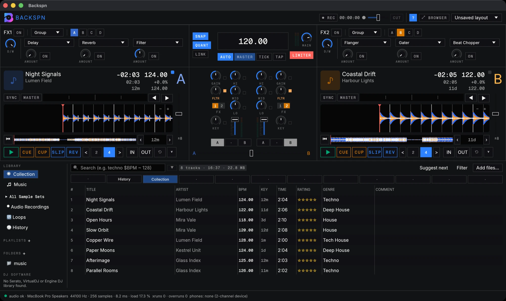
</p>

Mix with sync and keylock, split any track into stems on your own machine and
play 74 effects on the beat. Backspn is written in Rust, runs on macOS,
Windows and Linux, and is released under the GPL.

> **Status: public beta.** Every feature below is finished. Download a build
> for macOS (`.dmg`), Windows (`.exe`) or Linux (`.deb`, AppImage) from
> [Releases](https://github.com/suitux/Backspn/releases), or build it from
> source (see [Building](#building)). Please report what breaks in
> [Issues](https://github.com/suitux/Backspn/issues); testers with a
> controller are especially welcome.
>
> The beta builds are not notarised by Apple or signed for Windows yet (see
> [Installing on macOS](#installing-on-macos)). On Windows, choose
> **More info ▸ Run anyway** in SmartScreen.

### Installing on macOS

While Backspn is in beta, the macOS build is not notarised: that needs a paid
Apple developer certificate, which will come once the app has more users.
Until then, macOS blocks it the first time you open it:

1. Drag Backspn to Applications and open it. macOS shows *"Backspn" Not
   Opened*. Press **Done** (not *Move to Bin*).

   <p align="center">
     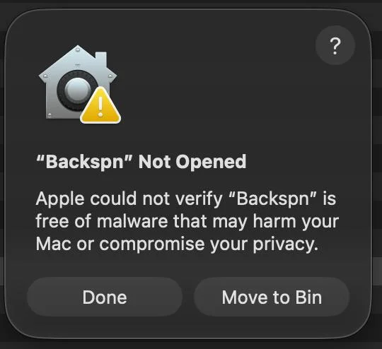
   </p>

2. Open **System Settings ▸ Privacy & Security**, scroll down to *Security*
   and press **Open Anyway** next to *"Backspn" was blocked to protect your
   Mac*. Confirm with your password or Touch ID.

   <p align="center">
     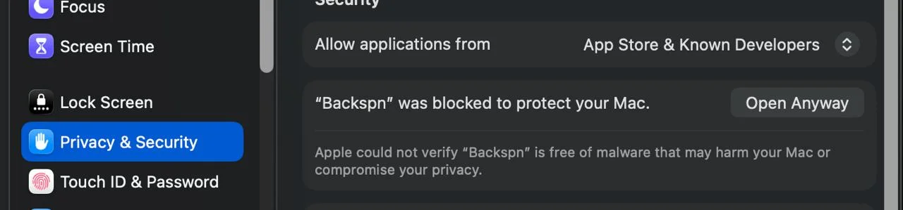
   </p>

3. Open Backspn again and choose **Open**. You only need to do this once per
   version.

## Features

- [Decks and mixer](#decks-and-mixer)
- [Stems](#stems)
- [Effects](#effects)
- [Drum Machine](#drum-machine)
- [Sample decks](#sample-decks)
- [Loop recorder](#loop-recorder)
- [Mix recorder](#mix-recorder)
- [Library](#library)
- [Layouts](#layouts)
- [Themes](#themes)

### Decks and mixer

Two or four decks. Sync locks every deck to the master clock, half and double
time included, and keylock keeps the pitch while the tempo moves. Each deck
has eight hotcues, loops and beat jump from 1/32 to 64 beats, slip and reverse.
The four-channel mixer has an isolator EQ, a filter (standard or a resonant
club filter), a crossfader, cue on a second output and a limiter on the master.

### Stems

Split any track into drums, bass, other and vocals on your own CPU. You don't
need a GPU, and once the separation model is downloaded you don't need a
connection either. Load the track as a stem deck and each part gets its own
volume, filter and FX send. Results are saved, so the next load is instant.
`.stem.mp4` files load as stems too.

<p align="center">
  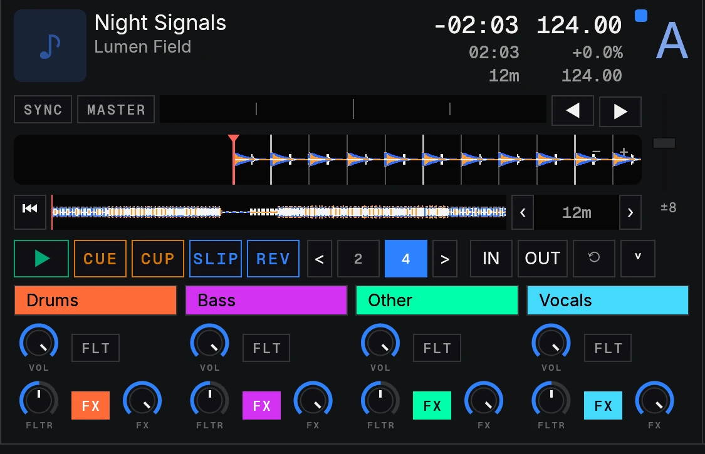
</p>

### Effects

74 effects timed to the beat of their deck. There are two or four FX units,
each in group mode (three effects) or single mode (one effect with all its
parameters), with insert, post-fader or send routing.

| Kind | Effects |
|---|---|
| Delay and echo | Delay, Delay II, Tape Delay, Beat Delay, Reverse Delay, Multi Tap Delay, Ramp Delay, Echo, Ping Pong, Pitch Echo, Coil Echo, Low Cut Echo, Low Cut Pitch Echo, Rising Echo, Release Echo |
| Reverb | Reverb, Reverb II, Glass Reverb, Beat Reverb |
| Filter | Filter, Beat Filter, Formant Filter, Peak Filter, Ladder LFO, Ladder Pulse, SVF Filter, SVF LFO, SVF Pulse |
| Modulation | Flanger, Flanger Pulse, Flanger Hold, Beat Flanger, Phaser, Phaser Pulse, Phaser Hold, Beat Phaser, Barber Pole, Shepard Saw, Shepard Tri, Shepard Jet, Ringmod, Pan |
| Rhythm and slicing | Gater, Beat Chopper, Slicer, Trans, Roll, Slip Roll, Reverse Roll, Step Stutter, Auto Step Stutter |
| Pitch and time | Pitch, Transpose Stretch, Stretch, Reverse Grain, Turntable, Vinyl Brake, Release Brake, Back Spin |
| Distortion | LoFi, Drive |
| Macros | Tunnel, Zap Cut, Grain Sweep, Bass Machine, Stretch Fast, Stretch Slow, Polar, Horizon, Zap, Dark, Flight |
| Effect modifiers | Filter, Decay |

### Drum Machine

Any FX unit can turn into a step sequencer that plays in time with the
master clock. Pick a kit and a sound, switch between the kit's eight patterns,
change pitch and decay from the knobs, and turn on duck so each hit dips the
deck.

<p align="center">
  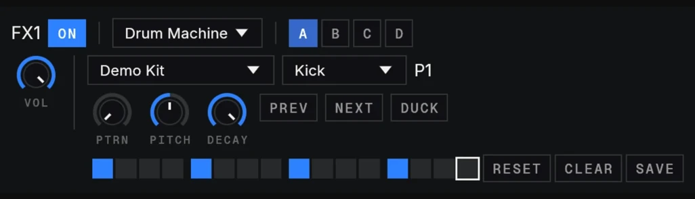
</p>

Two kits come with the app, **Analog Kit** and **Club Kit**, each with eight
sounds and eight patterns. Their sounds are synthesized by Backspn itself, so
they are as free as the rest of the code. Build more in
**Preferences ▸ Drum Machine**:

- **New**, **Duplicate** and **Delete** kits, and give each one a name and an author.
- **Add sounds…** loads your own samples in any supported audio format. Rename
  each sound, set its level, preview it in the headphones or remove it.
- Write your own **patterns**: eight per kit (P1 to P8), with a step row for
  every sound. Each row has its own step size: 1/4, 1/8 or down to **1/16 of a
  beat** (16, 32 or 64 steps per bar), so a straight kick can run under fast
  hat rolls in the same pattern.
- Choose the decay, pitch, pattern and volume a kit starts with when it is
  picked.
- **Export…** a kit as one `.bskit` file with its sounds inside, and
  **Import…** kits other people share.

<p align="center">
  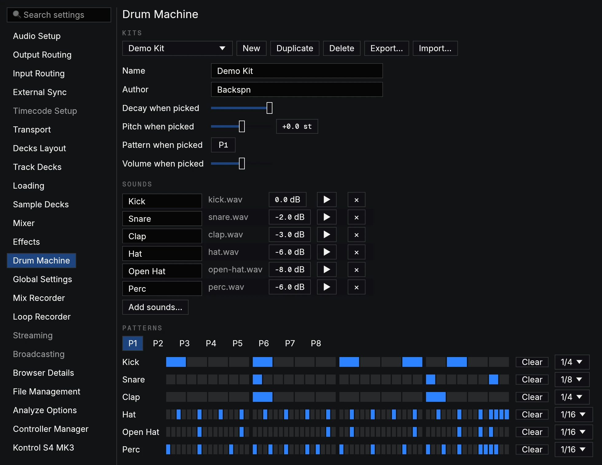
</p>

<p align="center">
  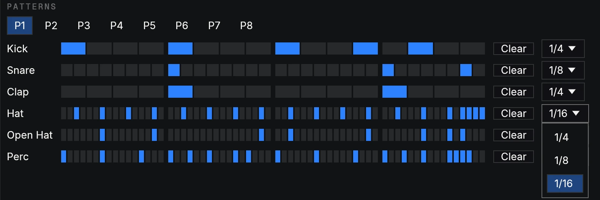
</p>
<p align="center"><sub>One pattern, three step sizes: kick in 1/4 of a beat, snare in 1/8, hats and percussion in 1/16.</sub></p>

### Sample decks

Any deck can become a sample deck with four slots. Each slot holds a stack of
cells. Drag loops and one-shots from the browser into the cells, then fire them
on the beat. Every slot has loop or one-shot playback, gate or latch triggers,
keylock, punch-in, size ÷2 and ×2, reverse, and its own volume, filter and FX
send. Sample sets are saved in the library.

<p align="center">
  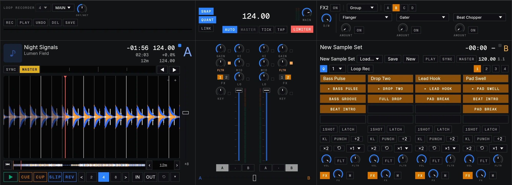
</p>

### Loop recorder

Record a loop of 4, 8, 16 or 32 beats from the master, the cue, or an external or
aux input. It plays back in time with the clock, and you can overdub layers and
undo them. Save the loop to the Loops list in the browser, or drag it straight
onto a sample deck cell.

<p align="center">
  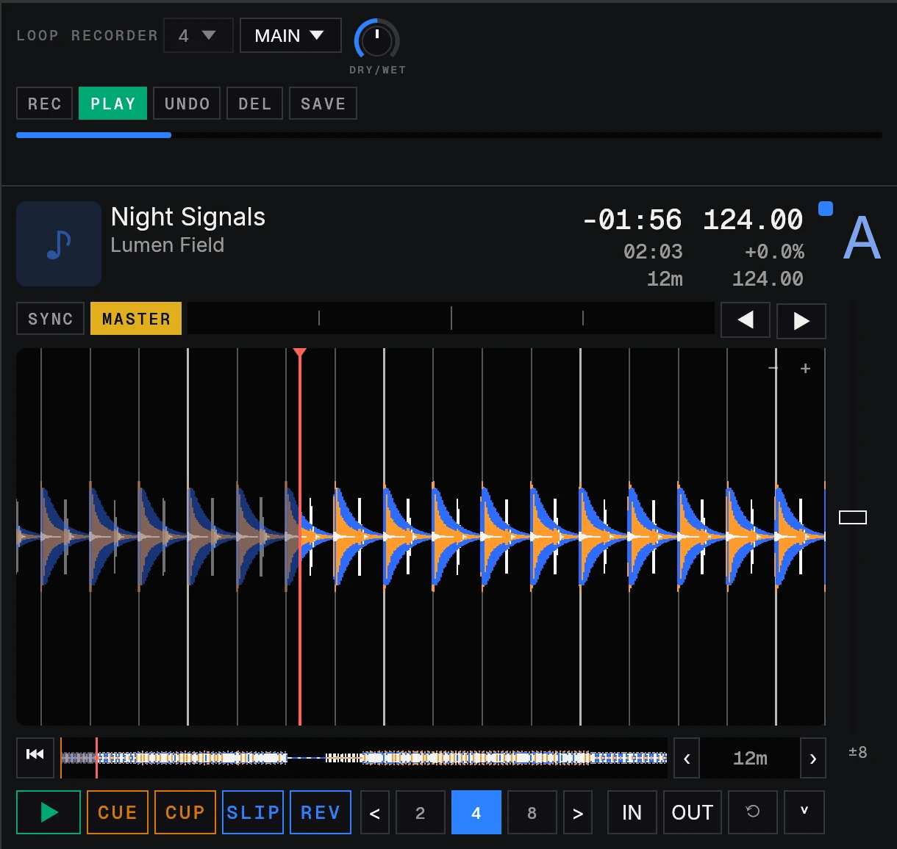
</p>

**Loops from a deck.** Any active loop on a track deck can become a sample too.
Right-click the loop on the waveform and choose **Save as Loop**: it goes to
the Loops list in the browser, named after the track and the time. You can
also drag the loop straight onto a sample deck cell, or onto Loops.

<p align="center">
  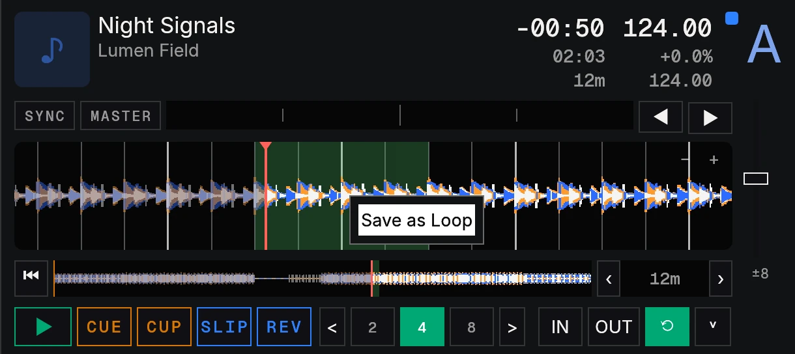
</p>

<p align="center">
  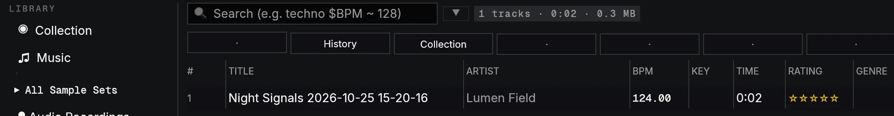
</p>

### Mix recorder

Record the whole mix to WAV (16-bit, 24-bit or 32-bit float), split by file
size if you want, with its own gain. Recordings show up in the browser under
Audio Recordings.

### Library

Every track is analysed when it loads: BPM, beatgrid, key and EBU R128
loudness. The library has search (with filters such as `techno $BPM ~ 128`),
playlists, smartlists, ratings, history, configurable columns and keyboard
navigation, and plays MP3, AAC/M4A, ALAC, FLAC, WAV, AIFF and Ogg Vorbis.
Backspn imports the collections of other DJ applications (NML collections,
keyboard and controller mappings) and reads Serato, VirtualDJ and Engine DJ
libraries. Everything it writes uses its own open formats.

### Layouts

Each deck can be Micro, Essential, Full or Advanced, or show its waveform in
a parallel lane with the other decks. Hide the browser or the FX units when
you need room. Save your setups as layouts and switch between them from the
top bar.

<p align="center">
  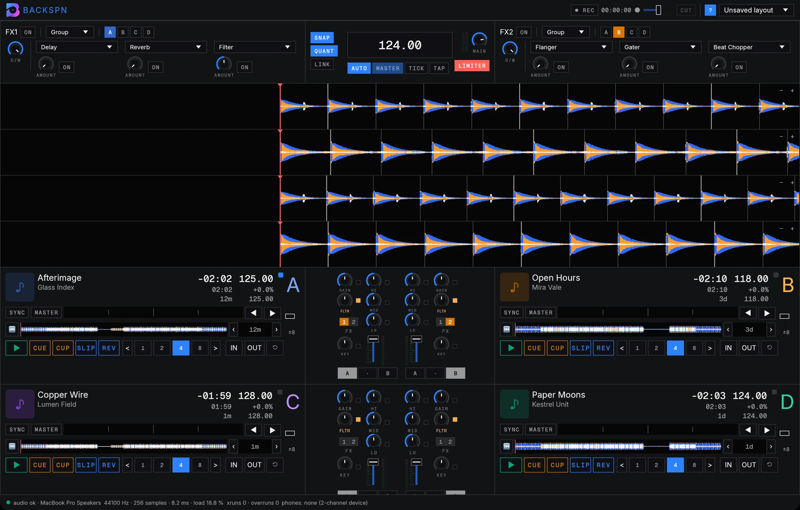
</p>
<p align="center"><sub>Parallel waveforms for four decks.</sub></p>

<p align="center">
  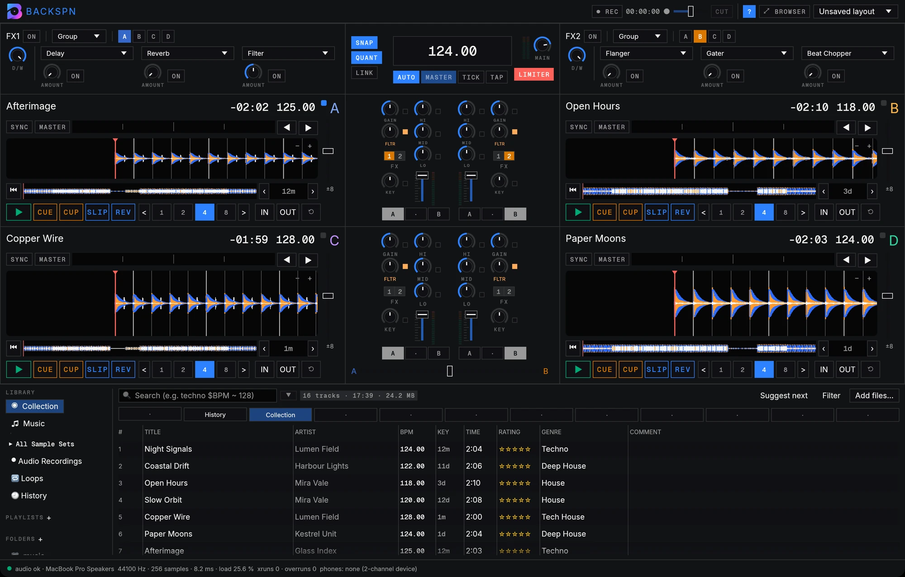
</p>
<p align="center"><sub>Four Essential decks with the browser.</sub></p>

### Themes

Dark, Light, Darcula, Solar, Purple and Ocean, from Preferences ▸ Global
Settings.

<p align="center">
  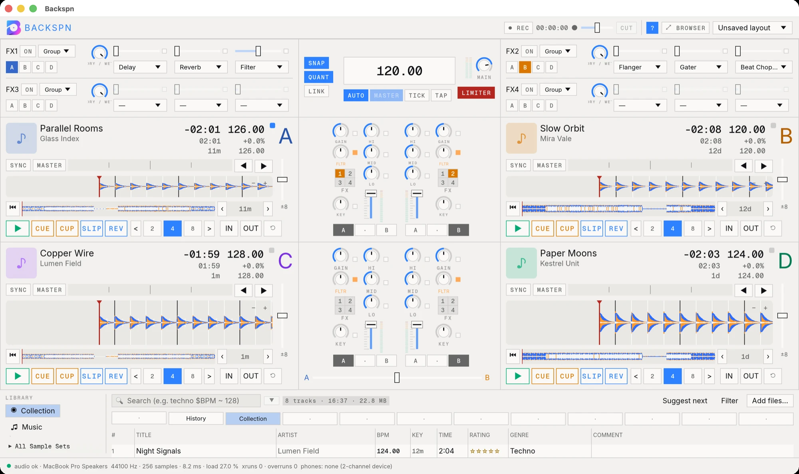
</p>
<p align="center"><sub>Light.</sub></p>

<p align="center">
  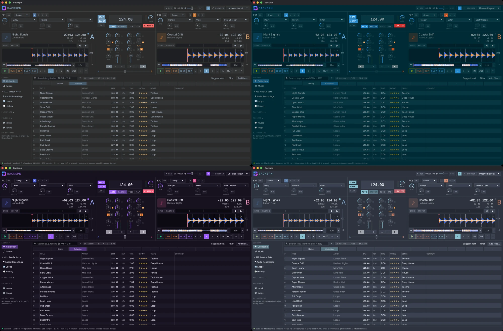
</p>
<p align="center"><sub>Darcula, Solar, Purple and Ocean.</sub></p>

## Controllers

| Kind | Brand | Models |
|---|---|---|
| Native drivers (HID) | Native Instruments | Kontrol S4 MK3\*, S4 MK2, S2 MK3, S2 MK2, S3, MX2, X1 MK2, X1 MK3, F1, Z1, Z2 |
| MIDI profiles | AlphaTheta | DDJ-FLX2, DDJ-FLX4, DDJ-GRV6 |
| | Pioneer DJ | DDJ-200, DDJ-400, DDJ-800, DDJ-1000, DDJ-ERGO, DDJ-FLX6, DDJ-RB, DDJ-REV5, DDJ-RR, DDJ-RX, DDJ-RZ, DDJ-RZX, DDJ-SB, DDJ-SB2, DDJ-SP1, DDJ-SR, DDJ-SX, DDJ-SX2, DDJ-SZ, DDJ-WeGO, DDJ-WeGO2, DDJ-WeGO3, DDJ-WeGO4, DDJ-XP1, DDJ-XP2 |
| | Denon DJ | MC7000 |
| | Hercules | DJControl Inpulse 200, 300, 500 |
| | Numark | Mixtrack Pro FX, Mixtrack Platinum FX |
| | Reloop | Buddy, Ready |
| Anything else | | MIDI learn and keyboard mappings |

<sub>\* Only the Kontrol S4 MK3 is tested on hardware so far. The others should
work, but they have not been tried on the real device yet and may have bugs.
If you own one, please [report](https://github.com/suitux/Backspn/issues) what
works and what doesn't.</sub>

The S4 MK3 driver draws its own screens, with four layouts to pick from:

<p align="center">
  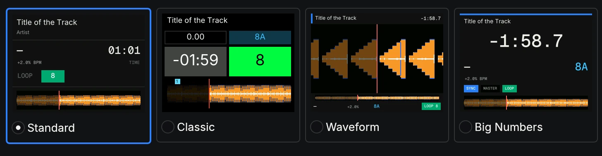
</p>

Profiles live in [`crates/control/profiles/`](crates/control/profiles/).
Several of them are adapted from [Mixxx](https://github.com/mixxxdj/mixxx)
mappings (see [MIXXX-NOTICE.md](crates/control/profiles/MIXXX-NOTICE.md)).
Controller names are trademarks of their owners and are used only to identify
the hardware.

**S4 MK3 screens**: the manufacturer's background services (`NIHardwareAgent`
and `NTKDaemon`) hold the screens, so Backspn can't draw on them while they
run. Stop them before opening Backspn. They start again with the manufacturer's
apps or after a restart, so repeat this if the screens stay blank.

- **macOS**: open Activity Monitor, search for `NIHardwareAgent`, select it
  and press the ✕ button (Force Quit). Do the same for `NTKDaemon`. Or, in
  Terminal: `killall NIHardwareAgent NTKDaemon`
- **Windows**: open Task Manager (Ctrl+Shift+Esc), go to the Details tab,
  right-click `NIHardwareAgent.exe` and choose End task. Do the same for
  `NTKDaemon.exe`.
- **Linux**: the manufacturer ships no services for Linux, so there is nothing
  to stop.

**Linux**: to reach HID controllers and the S4 MK3 screens without `sudo`,
install the udev rules and plug the controller in again:

```sh
sudo cp packaging/linux/99-backspn.rules /etc/udev/rules.d/
sudo udevadm control --reload && sudo udevadm trigger
```

**Windows**: buttons, lights and audio work with the manufacturer's driver.
The S4 MK3 screens use raw USB and need the WinUSB driver on the device's
interface 4 (for example, with Zadig), installed with the manufacturer's
hardware service closed. Untested.

## Building

You need stable Rust ([rustup](https://rustup.rs); the toolchain is pinned in
`rust-toolchain.toml`), CMake and a C/C++ compiler with libclang.

- **macOS**: Xcode command line tools and `brew install cmake`.
- **Windows**: Visual Studio Build Tools (C++), CMake and LLVM.
- **Linux** (Debian/Ubuntu):
  ```sh
  sudo apt install build-essential cmake pkg-config libclang-dev libasound2-dev \
    libudev-dev libxkbcommon-dev libwayland-dev libgl1-mesa-dev libx11-dev
  ```

Then:

```sh
git clone https://github.com/suitux/Backspn
cd Backspn
cargo run --release -p backspn-app             # optionally pass up to 4 audio files to load
```

Settings live in `settings.json` in your system's data folder (override with
`BACKSPN_SETTINGS`): `~/Library/Application Support/Backspn` on macOS,
`%APPDATA%\Backspn` on Windows and `~/.local/share/Backspn` on Linux.

## Anonymous usage statistics

Backspn can send an anonymous summary once a day so its developer knows how it
is used. The aggregated results are public at
[backspn.com/insights](https://backspn.com/insights). Nothing is sent until
you answer the notice shown on first launch.

**What is sent**: a random install ID (a new one after *Reset All Settings*),
the version, the system and processor, the interface language, the sample rate,
buffer size and channel count, whether headphones cue is set up, the models of
the supported controllers you connect, the number of tracks, analysed tracks
and playlists with a count per file format, a few settings (number of decks
and FX units, quantize, snap, auto gain, external mixer, Link, MIDI clock) and
counts of what happened since the last report: sessions, time open, playing
and recording, tracks loaded and played, mixes, recordings, stems separated,
sync, hotcues, loops, beat jumps, samples, auto fades, Link sessions, effects
switched on (per effect), imports (per kind), presses from a controller or the
keyboard, crashes and unexpected closes.

**What is never sent**: track, artist or playlist names, file paths, tags,
names of audio or MIDI devices, the content of logs or crash reports, and your
IP address (the server does not store it).

**See it and switch it off**: Preferences ▸ Global Settings ▸ Anonymous Usage
Statistics shows the exact report, when the last one was sent, and a switch.
`BACKSPN_INSIGHTS=0` turns it off for good. Development builds never send.

The collector is a Cloudflare Worker in [`insights/`](insights/).

## Contributing

Bug reports, controller profiles and pull requests are welcome. The workspace
layout, coding practices, tests and release process are described in
[CONTRIBUTING.md](CONTRIBUTING.md), and the visual rules of the interface in
[docs/design.md](docs/design.md).

## License

Copyright (C) 2026 Xavier Rincón.

Backspn is free software: you can redistribute it and/or modify it under the
terms of the GNU General Public License as published by the Free Software
Foundation, either version 3 of the License, or (at your option) any later
version (`GPL-3.0-or-later`). It is distributed without any warranty. Full
text in [`LICENSE`](LICENSE).

The Backspn name and logo (`crates/app/icon/`) identify this project and are
not covered by the code license. Third-party components keep their own
licenses: the Inter and Geist Mono fonts are under the SIL Open Font License 1.1
(`crates/app/fonts/OFL-*.txt`), and every Rust dependency is under a license
compatible with the GPL-3.0 (MIT, Apache-2.0, MPL-2.0, BSD, ISC, Zlib,
Unicode-3.0…).

All other product names mentioned here are trademarks of their respective
owners. Backspn is not affiliated with or endorsed by any of them.

## Technical reference

### Files and folders

**Data folder**: `~/Library/Application Support/Backspn` on macOS,
`%APPDATA%\Backspn` on Windows, `~/.local/share/Backspn` on Linux. Three
environment variables move it: `BACKSPN_SETTINGS` points to another
`settings.json` (the window state, kits, model and logs go next to it),
`BACKSPN_LIBRARY` to another `library.sqlite` (covers and backups go next to
it) and `BACKSPN_MAPPINGS` to another `mappings.json`.

| Path | Contents |
|---|---|
| `settings.json` | Preferences and the session state (decks, mixer, FX units) |
| `ui-state.ron` | Window size and panel state |
| `mappings.json` | Controller and keyboard mappings |
| `library.sqlite` | The library: tracks, analysis, cues, playlists, history and sample sets |
| `Kits/<kit>/` | Drum Machine kits: a `kit.json` plus the kit's sounds |
| `Covers/` | Imported cover art |
| `models/htdemucs_fp16weights.onnx` | The stem separation model, downloaded on first use |
| `Backup/` | Library backups and `.bak` copies made before settings are rewritten |
| `Logs/Backspn.log` | The session log |
| `Crashlogs/last-crash.txt` | The report of the last unclean exit |
| `insights.json` | The random install ID and the usage counts not yet sent |

**Music folder**: `~/Music/Backspn/` (each folder can be changed in
Preferences).

| Folder | Contents |
|---|---|
| `Stems/` | Generated stems (`.bstem`, Opus audio) |
| `Samples/` | Captured samples and loops |
| `Sample Sets/` | Exported sample sets, one folder with a `set.json` each |
| `Recordings/` | Mix recordings (WAV) |

### Formats Backspn writes

| Extension | Contents |
|---|---|
| `.backspn` | A collection, playlist or history |
| `.bsmap` | A controller mapping |
| `.bskit` | A Drum Machine kit with its sounds |
| `.bstem` | The four stems of a track |
| `set.json` | A sample set, inside its folder |
| `.m3u` / `.m3u8` | Standard playlists |
| `.wav` | Mix recordings |

### Formats Backspn only reads

Audio: MP3, AAC/M4A, ALAC, FLAC, WAV, AIFF, Ogg Vorbis and `.stem.mp4`.
Imports from other DJ applications: NML collections, the transient cache,
`.tsi` keyboard and controller mappings, and Serato, VirtualDJ and Engine DJ
libraries. Backspn never writes these formats, and it refuses to save into
another DJ application's data folder.
